# E30 Parts Website – Coursework Report

**Student:** Nikiforos Kassotakis
**Course:** ITC 4214 Internet Programming
**Professor:** Leonardos Mageiros
**GitHub repository:** https://github.com/nikiforoskassotakis3-arch/E30_Parts_Website

My goal was to build a website for BMW E30 owners where users can add, edit and track restoration and maintenance jobs. They can also see their progress on an analytics page and job board, and read a guide to common E30 parts, when to replace them and their price range.

## Technologies Used
HTML5, Bootstrap 5.3.3 and Bootstrap Icons 1.11.3 (from a CDN), plain JavaScript (no jQuery) and one small custom CSS file. Jobs are saved in the browser with localStorage.

## Pages
Home: welcome section, "What we offer" boxes, latest activity, garage weather (Open-Meteo API)
Tasks: add, edit, complete and delete jobs, with summary counts, search, filters and sorting
Analytics: progress bars and a job board (To do, In progress, Completed)
Parts: my page of choice – parts table, photo gallery and maintenance tips
About: about the site, team members and testimonials carousel
Contact: contact form with validation, a confirmation pop-up and a Google Map
Every page has the same sticky navbar and the same footer.

# 1 Description of the Task System

## How the job tracker works
Each job is a JavaScript object: id, name, description, due date, priority (High, Medium, Low) and status (To do, In progress, Completed).
All jobs are kept in one array. The array is saved in the browser with localStorage, so jobs stay after a refresh or when the browser is closed.
The Tasks page and the Analytics page read the same saved array, so a change on one page shows on the other.
Every action (add, edit, complete, delete, move) is also recorded in a short activity list, which the Home page shows.
The dark mode choice is also saved in localStorage, so it stays on across all pages.

## Code organisation
main.js is used on all pages for dark mode and the shared functions (loading and saving jobs, finding a job, priority colours, loading and adding activity).
tasks.js is used only by tasks.html to add, edit, complete, delete, search, filter and sort jobs.
analytics.js is used only by analytics.html to fill the progress bars and the job board.
home.js is used only by index.html for the latest activity list and the weather API.
contact.js is used only by contact.html for the contact form validation and confirmation pop-up.
style.css is used by all pages and adds four small custom rules on top of Bootstrap.

Shared functions are written once in main.js and reused by the other files, so no code is repeated. Each page only loads the scripts it needs, with the defer attribute so they run after the HTML has loaded.

# 2 Coding Decisions: Tasks Page

I built the Tasks page around one saved array of job objects. Every change updates the array, saves it, and redraws the table, so the page always shows what is saved.

## Form and validation
The form has a job name (required, max 50 characters), due date (required), priority (High, Medium, Low, with Medium pre-selected) and an optional description (max 200 characters).
The button is type="button" with onclick="addJob()", so the page does not reload when it is clicked.
addJob() function checks the fields with an if. If the name or due date is empty, a red message appears under the form instead of an alert, so the user can fix the field straight away.

## Adding a job
A new object is created with the status "To do" and added to the array with push().
Its id comes from getNextId(), which finds the biggest id and adds 1. I did not use the array position as the id, because positions change after a delete and two jobs could end up with the same id. After adding, the array is saved, the form is cleared, and the table is redrawn.

## Editing and deleting
Editing reuses the same form instead of a second form. editJob(id) copies the job's values into the fields and changes the button text to "Save changes".
A variable editingId remembers which job is being edited. 0 means a new job is being added. addJob() checks it to decide whether to add a new job or save the changes.
deleteJob(id) finds the job's position with findJobIndex() and removes it with splice(index, 1). If the deleted job was in the form, the form is cleared too.
The Complete button sets the status to "Completed". It is hidden for jobs that are already completed.

## The jobs table
showJobs() empties the table body and builds it again with insertRow() and insertCell(), one row per job.
Job text is written with textContent, so whatever the user typed is shown exactly as text and is never read as HTML.
The priority is a small coloured label made with createElement("span"). The colour comes from getPriorityClass(): red for High, yellow for Medium, green for Low. This function is in main.js because the Analytics page uses the same colours.
The Complete, Edit and Delete buttons pass the job's id, so each button knows which job it belongs to.
If there are no jobs, or nothing matches the search, the table shows one row with a message instead of being blank.
The table is inside a div with the overflow-auto class, so it scrolls sideways on a phone instead of breaking the layout.

## Summary
showSummary() counts the completed jobs with a loop. Total is the array length, and pending is total minus completed. It runs every time the table is redrawn, so the numbers are always up to date.

## Search, filters and sorting
getVisibleJobs() builds a new list of the jobs that match. It never changes the saved array, so clearing the search shows all jobs again.
Live search: the search text and each job's name and description are turned to lower case with toLowerCase(), then indexOf() checks whether the text appears. This makes the search ignore capital letters.
The search box uses the input event, which fires after every letter typed. The keydown event from the slides fires before the letter appears, so the results would be one letter behind.
Status filter: All, Pending or Completed. Priority filter: All, High, Medium or Low.
Sorting uses sort() with a compare function, because a plain sort() cannot sort objects by one of their properties. The function returns -1, 1 or 0 to say which job goes first. Due dates are saved as YYYY-MM-DD, so comparing them as text puts them in date order.

## Saving the jobs
saveJobs() turns the array into text with JSON.stringify() and stores it in localStorage.
loadJobs() reads it back with JSON.parse(), or returns an empty array the first time.
Both are in main.js so the Tasks and Analytics pages share them.

## Analytics and job board
setBar() works out a percentage with Math.round((count / total) * 100) and sets the progress bar width with element.style.width. One function fills all five bars, so no code is repeated.
The job board makes one card per job with createElement() and places it in the column that matches its status.
The buttons on each card (Start, Back, Done, Reopen) call moveJob(id, newStatus), which changes the job's status, saves the array, records the activity and redraws the bars and board. Moving a card therefore updates its status on the Tasks page too.

# 3. Coding Decisions: Latest Activity and API                                                                                                                           
The Home page shows the last 5 things the user did with their jobs.

addActivity(text) is in main.js, so the Tasks and Analytics pages can both call it. It is called on every add, edit, complete, delete and move.
Each entry is a small object with the message and the date and time. new Date() gives the current date, and toLocaleString() turns it into readable text, like 07/11/2026, 23:45:12.
unshift() puts the new entry at the front of the array, so the newest is first.

If the array has more than 5 entries, pop() removes the oldest one from the end. This keeps the list short and the saved data small.
The array is saved in localStorage under its own key, "activity", separate from the jobs.
showActivity() in home.js reads the array and creates one  li per entry with createElement() and appendChild().
If nothing has been recorded yet, the function stops with return and the "No activity yet" line from the HTML stays on the page.

I kept the activity in a separate list instead of working it out from the jobs, because a deleted job no longer exists in the jobs array, but "Job deleted" should still appear.

API integration: the Garage weather box uses fetch() to get the current temperature and wind speed in Athens from the free Open-Meteo API, which needs no key. .then() reads the JSON reply and writes it into the page with textContent. If the request fails, .catch() shows "Weather is not available right now" instead of leaving "Loading weather..." on the page.

# 4. Coding Decisions: Parts Page (Page of My Choice)
I chose a Parts guide because it fits the company theme: it shows which E30 parts wear out, when to replace them, and roughly what they cost. 

Parts table: a Bootstrap table table-bordered with a dark header , inside a div with overflow-auto. A table is the clearest way to compare the same details for 5 parts (timing belt kit, water pump, oil filter, front brake pads, spark plugs), and it scrolls sideways on phones.

Parts gallery: three figure elements in a Bootstrap grid  each with an image and a figcaption. The photos sit side by side on a computer and one under the other on a phone.

Maintenance tips: a Bootstrap list-group with a green check icon from Bootstrap Icons on each item, so the tips are quick to read.

Other decisions:
The original photos were 2–3 MB each, so I resized them to 800×600 JPG files (about 50–100 KB each). The page loads faster and the gallery lines up evenly.
img-fluid makes each photo shrink to fit its column, and img-thumbnail adds a rounded border.
Every image has alt text.
The captions are made bold by a rule in style.css, which is loaded after Bootstrap so my rule overrides Bootstrap's default.
The page needs no JavaScript of its own; it only loads main.js for dark mode.

# 5. Lighthouse Audit

| Page      | Performance | Accessibility | Best Practices | SEO |
|-----------|-------------|---------------|----------------|-----|
| Home      | 100         | 94            | 100            | 100 |
| Tasks     | 100         | 95            | 100            | 100 |
| Analytics | 100         | 93            | 100            | 100 |
| Parts     | 100         | 94            | 100            | 100 |
| About     | 100         | 93            | 100            | 100 |
| Contact   | 100         | 94            | 77             | 100 |

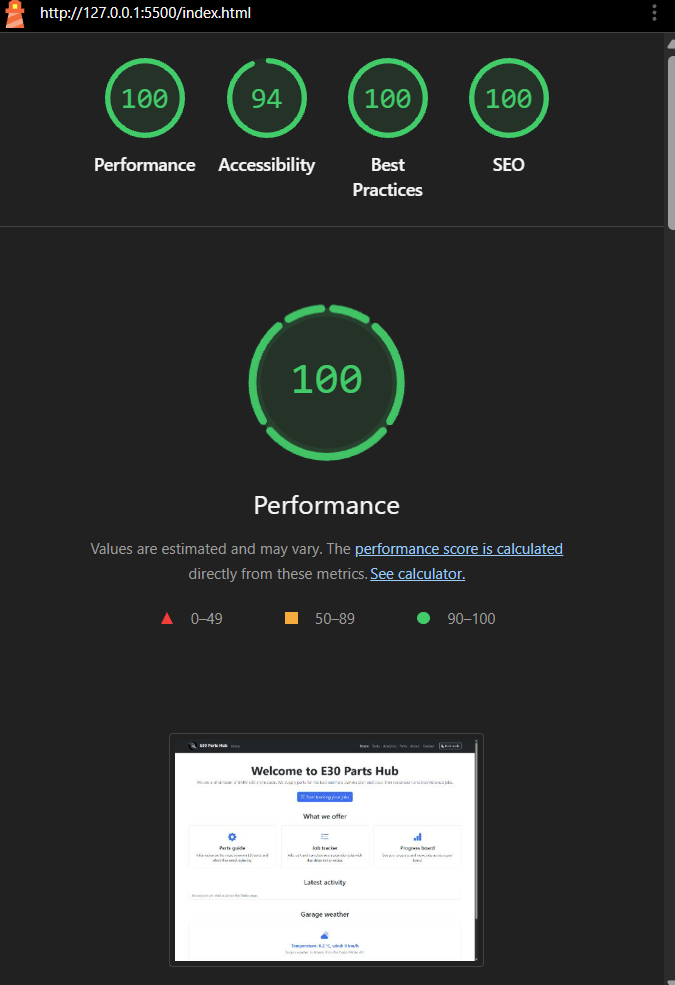
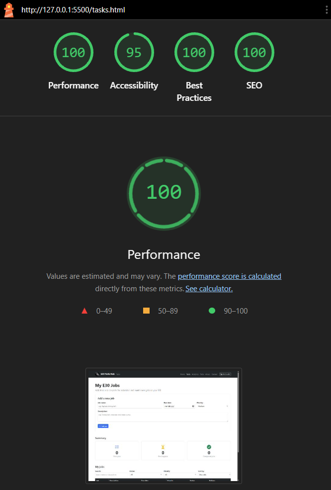
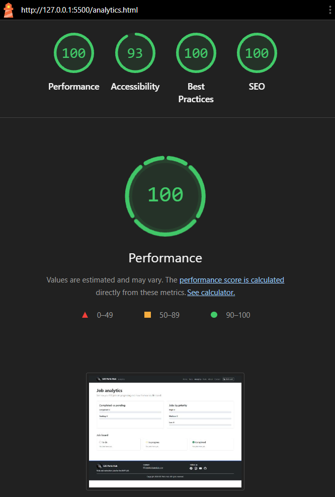
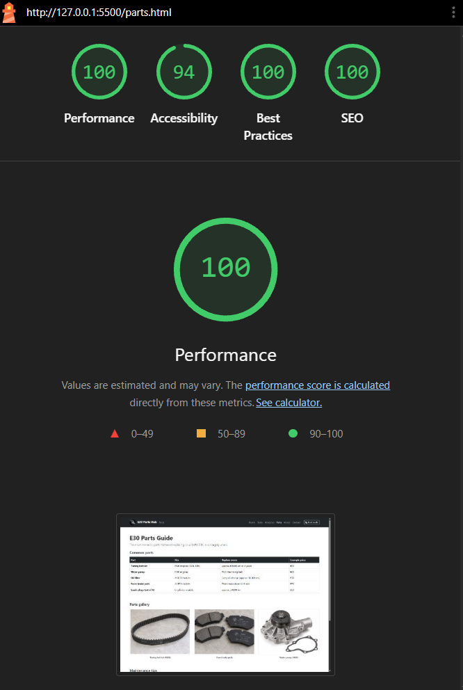
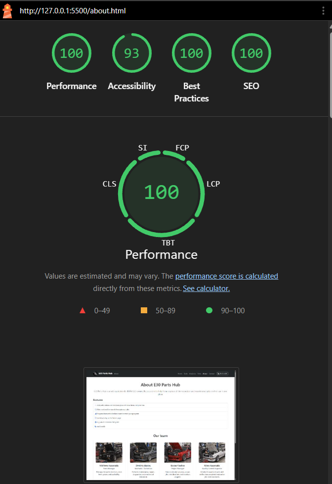
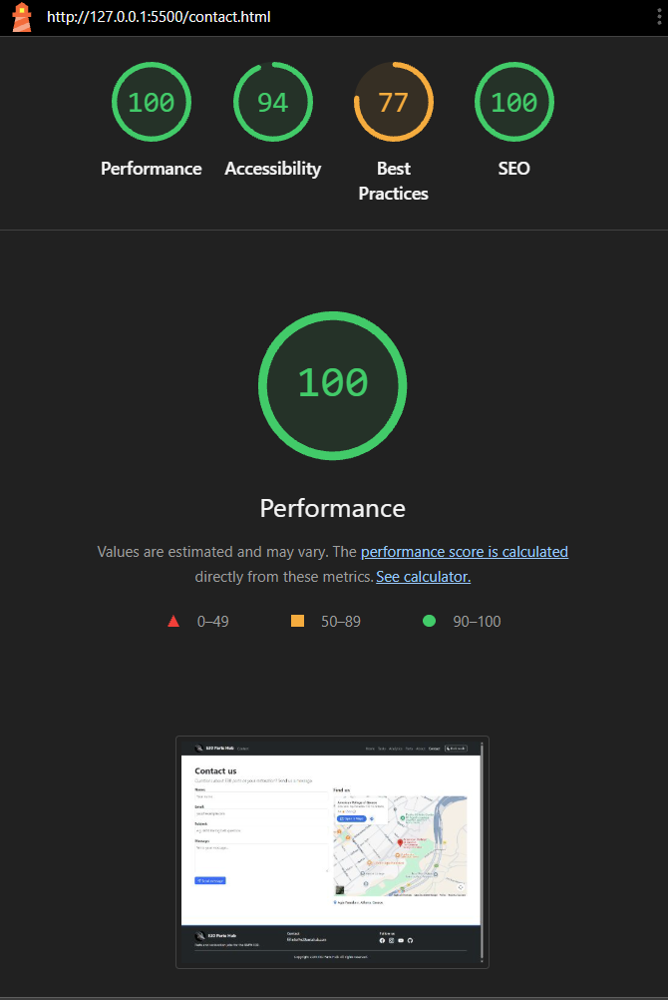

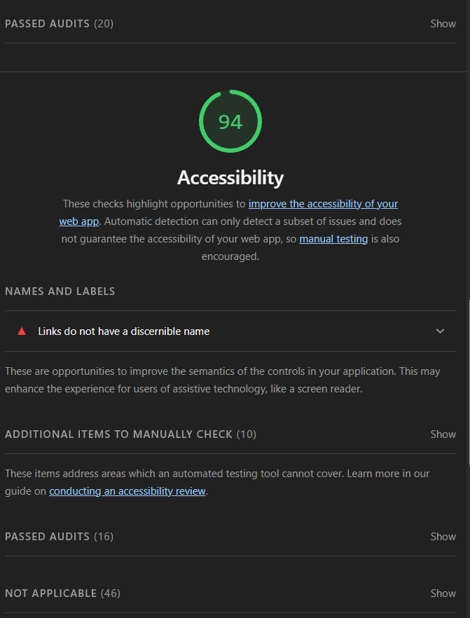

## Reflection
SEO (100): every page has its own title and meta description, the viewport tag and lang="en", and every image has alt text.

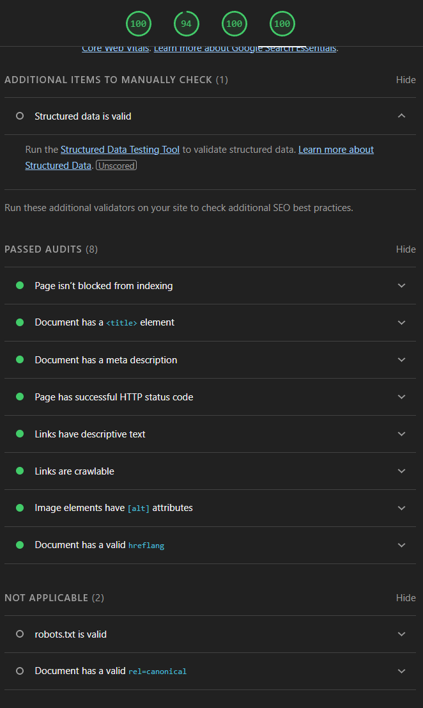

Accessibility (93–95-100): the only failed check was "Links do not have a discernible name". It comes from the 4 social media icons in the footer, which have no text, so a screen reader cannot say where they lead. I fixed it afterwards by adding the necessary hidden text inside each link with Bootstrap's visually-hidden class, which I had already used on the carousel arrows.After the fix, accessibility went up to a 100.

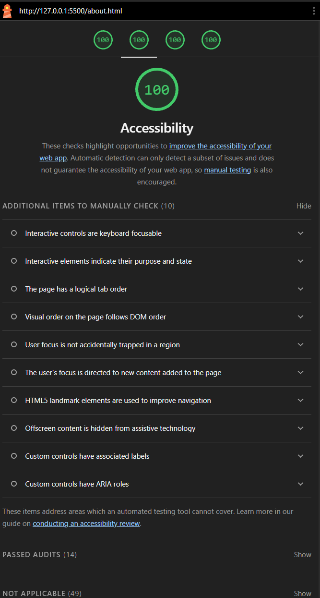

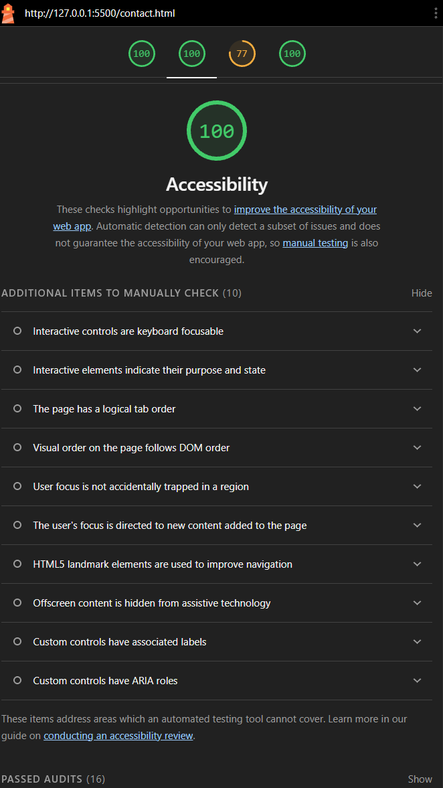

Best Practices (100, Contact 77): the Contact page is the only page with the embedded Google Map. The issues on that page most likely come from this third-party content, not from my own code.

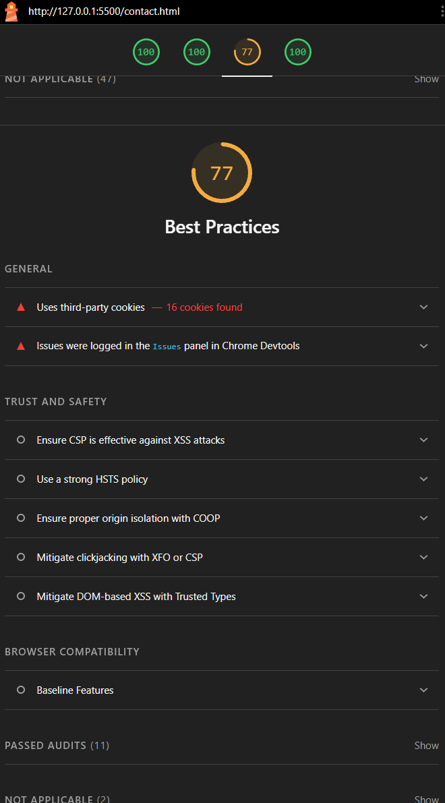

Performance (100): Lighthouse still suggested small improvements. "Render-blocking requests" (about 280 ms) comes from loading Bootstrap and Bootstrap Icons from a CDN. On the Parts page, "Improve image delivery" suggests even smaller photos; I had already reduced them from 2–3 MB to about 100 KB each.

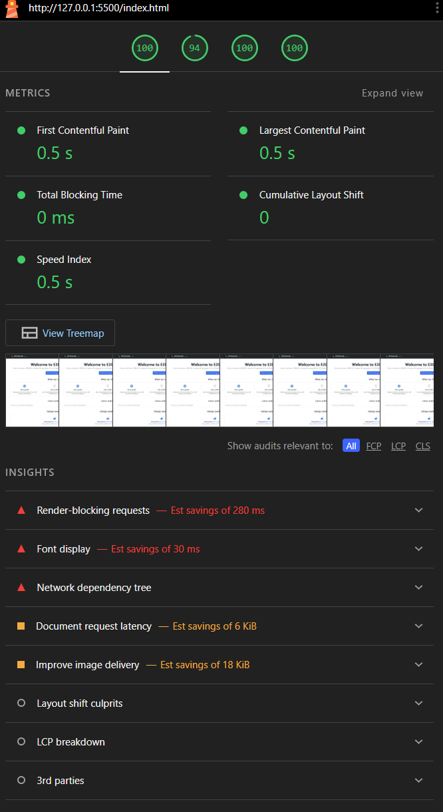

# 6. Personal Reflections

The biggest challenge was keeping the code as simple as possible so i can understand and have control over everything  while still meeting every requirement. I used the material we covered in the slides, as well as some  new additions only when the assignment needed it, such as localStorage for saving jobs and fetch() for the weather API.

Some other challenges i faced: 

1. Dark mode turned off every time I opened another page, because each page is a separate file. I saved the choice in localStorage and load it at the start of every page in main.js. 

2. The Tasks and Analytics pages both need to load, save and colour jobs. Writing the same functions twice would repeat code. I put the shared functions in main.js, which every page loads, and kept page-specific code in its own file. 

3. The live search was one letter behind when I used the keydown event. I used the input event, which fires after the letter has been typed. 

4. The original photos were 2–3 MB each and had different shapes, so the gallery was slow and uneven.  I resized them all to 800×600 JPG files of about 100 KB. 

5. I had trouble using some Bootstrap classes I wanted but were not in the course slides. I built the same look with classes like grid columns with border, rounded-2, p-4 and h-100 for boxes, and w-100 p-2 border rounded-2 for form fields.  

6. I needed a way to edit a job without making a second form.I reused the add form and used a variable, editingId, to remember whether the user is adding a new job (0) or editing an existing one. 

7. Using the array position as a job's id caused problems, because positions change after a job is deleted.  I wrote getNextId(), which finds the biggest id and adds 1, so every job keeps its own id. 

8. When a job was deleted it disappeared from the jobs array, so it could not appear in the latest activity. I kept the activity in its own saved list, separate from the jobs, so "Job deleted" still shows. 

9. If the weather API did not answer, the page stayed on "Loading weather..." forever. I added .catch() to show "Weather is not available right now" when the request fails. 

10. The contact form accepted email addresses that were not real, like "abc". I used indexOf() to check that the email contains "@" and ".", and showed an error if not. 

11. Lighthouse would not audit the pages when I opened them straight from the folder. I ran the site with the VS Code Live Server extension, so the pages had an http address. |

The most prevelant things i learnt through the creation of this website are how JavaScript changes a page through the DOM, how to keep data in the browser, and how  Bootstrap saves a lot of CSS. If I did the project again, I would plan the shared functions at the start instead of moving them into main.js later.